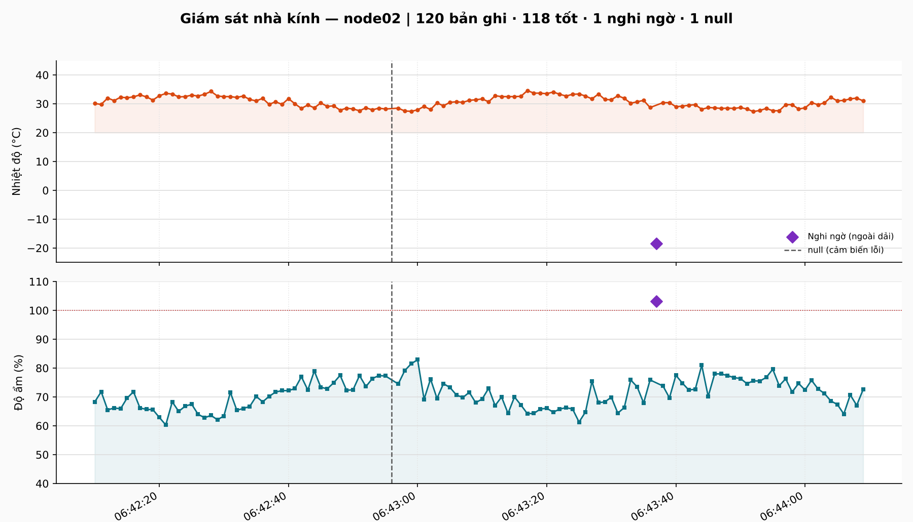

## 📊 1. Kết quả chính

### 1.1 Biểu đồ nhiệt độ – độ ẩm




| Ký hiệu trên biểu đồ | Ý nghĩa | Vị trí |
|---|---|---|
| Đường cam / xanh ngọc | Mẫu hợp lệ | 118 mẫu |
| Đường nét đứt xám | `null` — cảm biến lỗi, **không** vẽ thành 0 | `seq=47` (06:42:56) |
| Hình thoi tím | `suspect` — nằm ngoài dải vật lý | `seq=88` (06:43:37): −18.4 °C, 103.2 % |

Thống kê trên 118 mẫu tốt: nhiệt độ **27.3 – 34.6 °C** (TB 30.68 °C), độ ẩm **60.3 – 82.9 %** (TB 70.86 %).

### 1.2 Log trước / sau restart

Cùng một câu truy vấn, chạy ở hai thời điểm, kết quả **trùng khớp tuyệt đối** (`diff` không báo khác biệt, checksum MD5 hai file giống nhau: `13d9ff95…c7fa8a9d`).

| | `log_before_restart.txt` | `log_after_restart.txt` |
|---|---|---|
| Số bản ghi | 120 | 120 |
| `valid = 1` | 119 (gồm 1 `suspect`) | 119 |
| `valid = 0` (null) | 1 (`seq=47`) | 1 |
| `suspect = 1` | 1 (`seq=88`) | 1 |
| `seq` | 1 … 120, không thiếu | 1 … 120, không thiếu |


<summary>log<summary>

```text
id=1    device_id=node02 ts=1794811330 seq=1    temp=30.1   hum=68.3   rain=0 valid=1 suspect=0
id=2    device_id=node02 ts=1794811331 seq=2    temp=29.8   hum=71.8   rain=0 valid=1 suspect=0
id=3    device_id=node02 ts=1794811332 seq=3    temp=32.0   hum=65.5   rain=0 valid=1 suspect=0
...
id=47   device_id=node02 ts=1794811376 seq=47   temp=null   hum=null   rain=0 valid=0 suspect=0   <-- cảm biến lỗi
...
id=88   device_id=node02 ts=1794811417 seq=88   temp=-18.4  hum=103.2  rain=0 valid=1 suspect=1   <-- ngoài dải
...
id=120  device_id=node02 ts=1794811449 seq=120  temp=31.0   hum=72.6   rain=0 valid=1 suspect=0
-- Tổng: 120 bản ghi
```


Câu truy vấn dùng cho cả hai lần:
```sql
SELECT id, device_id, ts, seq, temp, hum, rain, valid, suspect, received_at
FROM   telemetry
WHERE  device_id = 'node02'
  AND  ts BETWEEN 1794811330 AND 1794811449
ORDER  BY ts ASC;
```

**Vì sao dữ liệu không mất sau restart?** SQLite chạy `journal_mode = WAL` + `synchronous = NORMAL`, nên giao dịch đã commit nằm trong file `greenhouse.db` trên đĩa; tắt tiến trình hay khởi động lại máy đều không ảnh hưởng.

### 1.3 Tải đồng thời (ghi MQTT khi có truy vấn nặng)

| Chỉ số | Không tải | Có query nặng | Chênh lệch |
|---|---:|---:|---:|
| Số lần ghi đo được | 25 | 40 | — |
| Trễ ghi trung bình | 1.912 ms | 3.364 ms | +1.452 ms (+75.9 %) |
| Trễ ghi lớn nhất | 3.087 ms | 48.530 ms | +45.443 ms |
| Query nặng chạy | 0 | 60 lần / 30 s | — |
| Trễ query nặng TB | — | 0.41 ms | — |

Query nặng (lặp mỗi 0.5 s):
```sql
SELECT device_id, COUNT(*), AVG(temp), AVG(hum), MIN(temp), MAX(temp)
FROM telemetry WHERE valid = 1 GROUP BY device_id;
```
→ Trễ ghi tăng ~76 % nhưng vẫn cỡ vài ms; đỉnh 48 ms là lúc hai tác vụ tranh nhau checkpoint WAL. Việc ghi **không bị nghẽn**.

---

## 🧾 2. Quy tắc kiểm dữ liệu trước khi ghi

| Tình huống | Cách xử lý |
|---|---|
| JSON hỏng, thiếu `device_id` / `ts` / `valid`, sai kiểu | Từ chối, lưu nguyên payload + lý do vào bảng `rejected_records` |
| `temp` / `hum` = `null` (DHT trả `NaN`) | Vẫn lưu, `valid = 0`; **không** đổi thành 0 |
| Giá trị `0` thật (0 °C, mưa = 0) | Là số đo hợp lệ, lưu bình thường |
| Ngoài dải (nhiệt −10…60 °C, ẩm 0…100 %) | Lưu kèm `suspect = 1` |
| Trùng `(device_id, ts, seq)` | Giữ bản đến **trước**, bỏ bản đến sau (an toàn khi MQTT QoS 1 gửi lại) |

Mẫu bản tin hợp lệ (`seq=105`, lấy từ log):
```json
{
  "device_id": "node02", "ts": 1794811434, "seq": 105,
  "temp": 28.4, "hum": 76.8, "rain": 0,
  "unit": {"temp": "C", "hum": "%", "rain": "binary"},
  "valid": true, "fsm_state": "RUNNING", "pump": 100
}
```

---

## 🔧 3. Kiến trúc & danh sách file

```text
ESP32 (FreeRTOS)  ──MQTT──►  Mosquitto  ──►  ingest_service.py ─┬─► SQLite (WAL)  greenhouse.db
 Core0: MQTT task/queue                                          └─► Firebase RTDB (luồng nền)
 Core1: FSM máy bơm + đọc cảm biến
 Web UI :80 (Canvas, xuất chart.png)
```

| Nhóm | File | Vai trò |
|---|---|---|
| Firmware | `src/main.cpp`, `include/config.h` | Đọc cảm biến, FSM an toàn bơm, gửi MQTT, Web Dashboard tự vẽ & xuất `chart.png` |
| Thu nhận | `ingest/ingest_service.py`, `schema.sql` | Subscribe, kiểm duyệt, ghi SQLite + đồng bộ Firebase; bảng `telemetry`, `rejected_records` |
| Truy vấn | `queries.sql` / `queries.md`, `query_timerange.py` | Truy vấn mẫu; lọc theo thiết bị + khoảng thời gian và vẽ biểu đồ |
| Kiểm thử | `restart_check.py`, `concurrent_load_test.py`, `concurrent_load_selftest.py`, `mock_publisher.py` | Kiểm tra bền vững, đo tải, phát MQTT giả lập |
| **Kết quả** | **`chart.png`**, **`log_before_restart.txt`**, **`log_after_restart.txt`**, `concurrent_load_result.txt` | Minh chứng nộp bài |

---

## ▶️ 4. Cách chạy

```bash
# 1) Broker
docker-compose up -d broker

# 2) Thư viện Python
pip install paho-mqtt matplotlib numpy

# 3) Service thu nhận (SQLite + Firebase; cấu hình trong .env:
#    FIREBASE_DATABASE_URL, FIREBASE_LEGACY_TOKEN)
python ingest/ingest_service.py

# 4) Truy vấn khoảng thời gian + xuất biểu đồ
python query_timerange.py --device node02 --t0 1794811330 --t1 1794811449 --save chart.png

# 5) Kiểm tra lưu bền: chạy → dừng/khởi động lại service → chạy lại
python restart_check.py

# 6) Thí nghiệm tải đồng thời
python concurrent_load_selftest.py
```

Nạp firmware bằng PlatformIO (sửa Wi-Fi/IP broker trong `include/config.h`). Xem biểu đồ trực tiếp tại `http://<IP_ESP32>/`, bấm **📸 Xuất & Tải chart.png**, hoặc mở `http://<IP_ESP32>/?auto_export=1` để tự tải.

Kết quả chạy `query_timerange.py`:
```text
Truy vấn: device=node02  T0=2026-11-16T06:42:10Z  T1=2026-11-16T06:44:09Z
Số bản ghi: 120 | Hợp lệ: 119 | Không hợp lệ: 1 | Nghi ngờ: 1 | seq: 1..120
```
